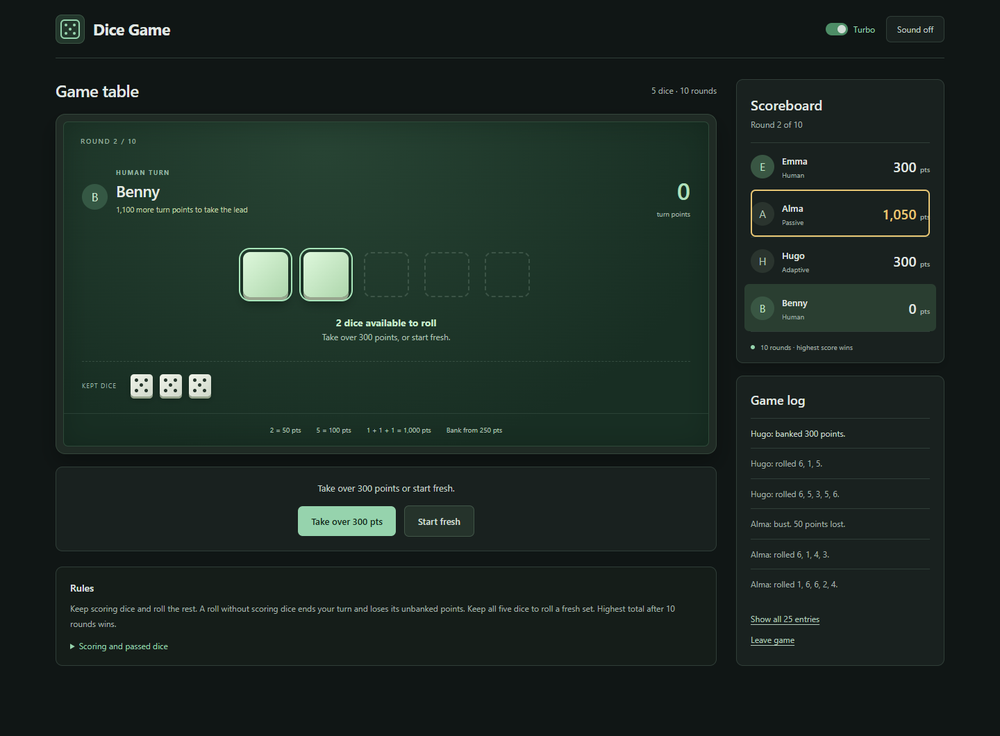

# DiceGame

A dice-rolling risk/reward game engine in C# with pluggable player strategies and a Monte Carlo simulator for evaluating them.



## Game Rules

Players compete over **10 rounds**, rolling up to 5 dice per turn and banking points based on what they keep.

### Scoring

| Dice | Points |
|------|--------|
| Three 1s | 1000 |
| Any 5 | 100 |
| Any 2 | 50 |
| 3, 4, 6 | 0 |

A player must accumulate at least **250 points** in a round before they can bank. If a roll yields no scoring dice, the entire round score is lost (bust).

After accepting passed points and dice, the player must roll and keep scoring dice at least once before banking, including when all five dice are available. In the web game, banking displays the result briefly and advances to the next player automatically.

### Turn Flow

1. Accept or reject the previous player's dice position and partial score
2. Roll the available dice (up to 5)
3. Select which scoring dice to keep
4. Roll again or stop and bank the round score
5. Pass to the next player

## Project Structure

```
DiceGame/          Core library — game engine, scoring, and strategy interfaces
Simulator/         Console app — runs strategy comparison simulations
DiceGame.Web/      Blazor WebAssembly — interactive dice game
DiceGame.Tests/    NUnit — interactive match rules and complete games
```

## Building & Running

Requires [.NET 10 SDK](https://dotnet.microsoft.com/download).

```bash
dotnet build
dotnet run --project Simulator
```

### Play in the browser

```bash
dotnet run --project DiceGame.Web
```

Open http://localhost:5180. Select 2–6 total players and 0–6 humans. Humans share the same device and are named Player 1, Player 2, and so on. The remaining seats are computers with selectable Passive, Bold, or Adaptive strategies; all-human and all-computer games are supported. The active player's name identifies whose turn it is. The interface is in English, with a dark game table, animated dice, a sticky scoreboard on desktop and mobile, and locally bundled CC0 sound recordings by [Kenney](https://opengameart.org/content/54-casino-sound-effects-cards-dice-chips). Sound starts after interaction and can be muted.

Edit human and computer names in setup. Names are saved locally in the browser and restored between games and sessions. Names must be nonempty and unique among active players. The Turbo switch in the header speeds up computer decisions, rolls, and turn transitions and can be changed during a match.

Before the first turn, every player rolls one die. Only players tied for the highest value reroll until one player wins the opening. The remaining players follow in their original seating order, starting from the opening winner. Match scoring, inheritance, and computer decisions follow the existing simulator; tied final scores share the victory.

The scoreboard stays in playing order with the starter first. Banked-score leaders have gold point totals; tied leaders are all highlighted. Each turn shows the additional points needed to bank an outright lead. During inheritance, green dice are available to roll, dimmed outlines are unavailable, and the passed kept dice appear below. Only opening contenders animate during a tiebreaker. The last-round alert sits inside the table caption without moving the table.

`InteractiveGame` is the shared rules engine for the web game and simulator. It advances one action at a time, allowing the human to select scoring dice, keep rolling, bank, and accept or decline passed positions. `Game` runs this same engine automatically using each player's `IPlayerStrategy`, keeping the simulator's seating order and optional shuffle. Rules and strategy decisions are implemented in one engine.

Rolling at least three ones triggers a short rising two-note “tu du” fanfare when sound is enabled. The fanfare is synthesized locally; the last-round announcement uses the browser's available speech voices.

```bash
dotnet test DiceGame.slnx
dotnet publish DiceGame.Web -c Release
```

The published `DiceGame.Web/bin/Release/net10.0/publish/wwwroot` directory can be served by a static web host. No backend or account is required. Sound attribution is included in `DiceGame.Web/wwwroot/audio/CREDITS.md`.

The simulator runs two scenarios with 25,000 games each:

- **Strategy Comparison** — Passive vs. Bold vs. Adaptive
- **Risk Analysis** — How the minimum-dice-to-roll threshold affects win rates

## Strategies

Strategies live in `DiceGame/Strategies` under the `DiceGame.Strategies` namespace and are instantiated as sealed records: `new PassiveStrategy()`, `new BoldStrategy()`, and `new AdaptiveStrategy()`. Their common threshold behavior lives in the abstract `ThresholdStrategy` record, which implements `IPlayerStrategy`. Records can be customized with `with` expressions.

To add a strategy to the web interface, add a public sealed record implementing `IPlayerStrategy` or deriving from `ThresholdStrategy` in the `DiceGame` project. Provide a public parameterless constructor, a unique `Name`, and a `Description`. The instance-based `PlayerStrategies` catalog discovers concrete strategies automatically; no central list or UI change is needed. The web application preserves the `DiceGame` assembly during trimming so newly discovered strategies remain available in Release builds. Additional assemblies can be supplied to the catalog and must also be preserved when trimming. Passive always declines passed points and dice, regardless of their value.

The last-round voice and sound cue are reduced to 60% of their previous volume: their individual volume settings changed from 0.6 to 0.36. Other sound levels are unchanged.

| Strategy | Stop Threshold | Behavior |
|----------|---------------|----------|
| Passive | 250 | Banks early, never takes inherited dice |
| Bold | 600 | Keeps rolling, always takes inherited dice |
| Adaptive | 350 (base) | Uses standings after banking; stops at 250 with one die or 300 with two dice |

### Key `ThresholdStrategy` Properties

| Property | Description |
|----------|-------------|
| `StopThreshold` | Base score to stop rolling at |
| `StopThresholdWhenLeading` | Adjusted threshold when the projected total after banking leads or ties the leader |
| `StopThresholdWhenTrailing` | Higher threshold when the projected total after banking is still behind |
| `StopThresholdByDiceCount` | Optional immutable map from remaining dice count to a lower stopping threshold; empty disables dice-based risk adjustments |
| `TrailingGapTrigger` | Point gap that activates trailing behavior |
| `StopThresholdFinalRounds` | Override threshold for the last N rounds |
| `FinalRoundsCount` | How many rounds count as "final" |
| `MaxRollsPerTurn` | Force-stop after this many rolls (0 = unlimited) |
| `TakeInheritanceMinScore` | Minimum inherited score worth accepting |
| `ChaseLeadInFinalRound` | Keep rolling in the last round if you can't catch the leader |
| `SecureWinOnFinalTurn` | Enabled by default; the last player in the final round may exceed dice-keeping limits and bank immediately to secure an outright victory |
| `MaxTwosToKeepPerRoll` | Maximum twos to keep from a roll unless securing a final-turn victory |
| `MaxFivesToKeepPerRoll` | Maximum fives to keep from a roll unless securing a final-turn victory |
| `MaxBustProbability` | Maximum acceptable next-roll bust probability, from 0 to 1; default 1 leaves this limit disabled |
| `MinimumExpectedNetGain` | Minimum expected point gain from the next roll, accounting for lost turn points on a bust; negative infinity disables this check |
| `TargetLeadMargin` | Desired point margin over the best opponent after banking; default 0 disables this target |
| `SimulationBudget` | Number of complete simulated continuations per candidate action; default 0 disables lookahead |
| `MaxDiceToPass` | Preferred maximum dice to leave for the next player, normally 1–5; default 5 disables this preference, Adaptive uses 4 |

Stopping decisions use `GameState.ProjectedTotalScore`, `IsLeadingAfterBanking`, and `PointsBehindLeaderAfterBanking`. Dice-based thresholds cap the usual position or final-round threshold. Adaptive uses a cap of 250 points with one remaining die and 300 with two; an all-kept hand resets to five dice. In the last round, chasing an outright lead still takes priority over these caps.

With `SecureWinOnFinalTurn`, a guaranteed final-turn win takes priority over normal stopping thresholds and limits for twos, fives, and triple ones. A tie does not trigger this exception. The engine still requires a scoring roll and at least 250 turn points before banking. Set the property to `false` to retain the ordinary limits.

`MaxDiceToPass` encourages another roll when banking would leave too many dice, including the fresh set of five after keeping all dice. Explicit bust-risk, expected-gain, and maximum-roll limits can still require banking. A guaranteed final-turn victory and a completed game do not sacrifice points merely to avoid passing dice.

Next-roll probabilities and expected gains enumerate every possible outcome, including triple ones and the strategy's dice-keeping limits. Risk and expected-gain limits also apply when considering inherited dice. These limits take priority over building a larger lead; final-round lead chasing and securing a guaranteed victory retain priority.

With a positive `SimulationBudget`, the strategy compares banking versus rolling, eligible inheritance versus starting fresh, and valid subsets of scoring dice. Simulations use the same `InteractiveGame` engine, opponent scores, actual computer strategies, and remaining turn order. Human opponents use their attached baseline strategy during simulations. Lookahead is disabled inside simulated continuations, so simulations cannot recursively simulate further games. Candidates use reproducible random samples, maximize estimated victory share, and break ties using expected final points; shared victories contribute a fraction of a win.

The additional settings are opt-in and can be combined on any threshold strategy:

```csharp
var optimizedStrategy = new AdaptiveStrategy() with
{
    MaxBustProbability = 0.45,
    MinimumExpectedNetGain = 0,
    TargetLeadMargin = 100,
    SimulationBudget = 64
};
```

`GameState.OpponentScores` is an immutable snapshot in seating order excluding the current player. `PlayersRemainingInRound` identifies how many opponents still have a turn this round. `BestOpponentScore` supports lead targets without comparing the player against their own banked score. Larger simulation budgets increase computation per decision and should be benchmarked against other strategies.

## Architecture

- **Strategy Pattern** — `IPlayerStrategy` decouples decision logic from game mechanics
- **Immutable Records** — `GameState`, `DiceSelection`, and `GameResult` are sealed records
- **State-Based Decisions** — Strategies receive a full `GameState` snapshot including relative standings
- **Thread-Safe RNG** — `Randomizer` wraps `Random` with locking for concurrent simulation runs
